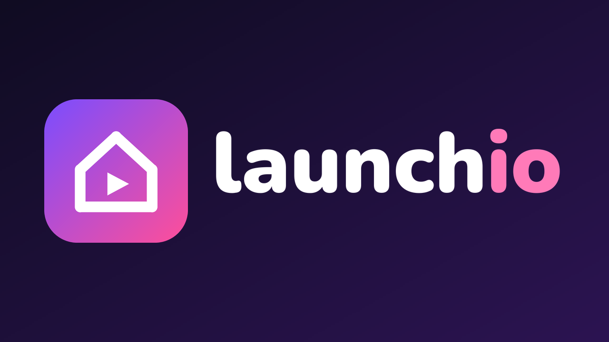

# Launchio



A home screen for Android TV and Google TV that plays nicely with
[Nuvio](https://github.com/NuvioMedia/NuvioTV). Built on the launcher from
[CleanYourTV](https://github.com/Gathin23/cleanyourtv) by Gathin.

> **Work in progress (0.2 line).** This is Launchio rebuilt on CleanYourTV's launcher. Launchio's
> features from the 0.1 line (Continue watching, the featured hero with your shows and
> recommendations, Nuvio's themes, TV inputs in the dock, now playing, the power menu) are being
> brought over stage by stage. Until then, the current release is
> [Launchio 0.1.1](https://github.com/peshke/launchio-legacy/releases/tag/0.1.1).

## Build and install

You need a JDK 17 or newer and the Android SDK (platform 34). Then:

```bash
TV_HOST=192.168.1.20 launcher/build-and-install.sh
```

The script builds a release APK, starts it on the TV before it touches the stock launcher, and
puts the stock launcher back if Home doesn't end up on Launchio. On Windows, use
`launcher/build-and-install.ps1`. A test build next to an installed Launchio:
`./gradlew assembleRelease -PlauncherApplicationId=io.github.peshke.launchio.dev` (in `launcher/`).

## Credits

Launchio is built on [CleanYourTV](https://github.com/Gathin23/cleanyourtv) by Gathin (MIT), and
its 0.1 line started from [tv-home](https://github.com/mihirgupta0900/tv-home) by Mihir Gupta (MIT).
Design language from [Nuvio](https://github.com/NuvioMedia/NuvioTV). The Outfit typeface is under the
SIL Open Font License (`launcher/FONT-LICENSE-OFL.txt`). Code is MIT, see [LICENSE](LICENSE).
