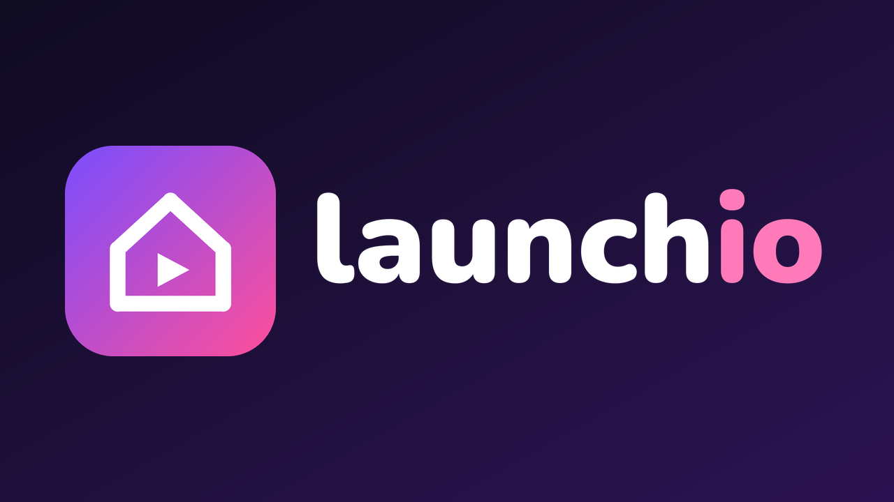

# Launchio



A home screen for Android TV and Google TV that plays nicely with
[Nuvio](https://github.com/NuvioMedia/NuvioTV): what you're watching, recommendations, your apps
and your TV inputs, in Nuvio's design language. No ads, no sponsored rows, nothing in the
background but the clock.

## What's on the home screen

- **The hero**: a big featured title behind the dock: backdrop, title logo, year, genres, rating
  and a short blurb, taking turns every 15 seconds. It mixes **what you're watching** (your last
  shows from Continue watching, with **Resume**) and **recommendations** (popular movies and series,
  with **Open in Nuvio**). Up from the dock to reach its button, Left/Right to flip through.
- **A dock** of your favourite apps and TV inputs, on a glass panel that fits them, left, centre or
  right. Below it, **every other app** in a grid.
- **Continue watching**: read from the system Watch Next list that apps like Nuvio fill: art,
  progress, season and episode; Select resumes playback.
- **Recommendation rows** from a Stremio-style catalog add-on ([Cinemeta](https://v3-cinemeta.strem.io)
  by default, no account or key): Popular, New and Featured movies and series. Picks open in Nuvio
  through its `nuvio://meta` link. Focusing any card fades the background to its backdrop.
- **TV inputs as tiles** (HDMI, AV, …) under the TV's own names: "PlayStation 5" instead of HDMI 1
  when the device speaks HDMI-CEC, with a "Connected" line. Their default banner follows the
  theme, or use a built-in photo. The **Inputs** button lists them the same way, in port order.
- **Now playing**: music playing in the background (YouTube Music, Spotify, TuneIn, or casting) shows
  under the top bar with previous / play-pause / next.
- **Top bar**: clock and date, **Inputs**, the network (Ethernet, Wi-Fi name, or Offline) and
  **Settings**: TV settings, **Home screen**, and **Restart** / **Turn off**.

Long press (or Menu) any tile or card for its options: move, add to or remove from the dock, hide,
app info; resume, details in Nuvio, watch the trailer, open in Stremio, remove from Continue watching.

## Settings › Home screen

- **Featured: recommendations**, **Featured: what I'm watching** (each on its own; the hero's
  recommendations don't depend on which rows are shown), **Continue watching**
- **Rows**: which catalog rows to show
- **Theme (as in Nuvio)**: Nuvio's 12 themes; White by default, the Supporter themes with
  gradient focus rings. **Font**: Inter or DM Sans
- **Background**: title art (follows the hero and the focused card), built-in photos, Bing photo of
  the day, or random photos from Picsum
- **Dock**: left, centre or right, reset to the default apps; **Hidden apps** to bring back

Defaults (dock apps, hidden apps, catalog add-on and rows, the app picks open in) are in
[launcher/res/values/config.xml](launcher/res/values/config.xml).

## Install

You need a JDK (17 or newer), the Android SDK (platform 34 and build-tools 35) and `adb`. On the
TV: Settings › System › About › press OK on **Build** 7 times, then Developer options › **USB
debugging** on. Then:

```bash
adb connect 192.168.1.20:5555                    # your TV's address; accept the prompt on the TV
TV=192.168.1.20:5555 launcher/build-and-install.sh
```

It builds the APK without Gradle, installs it, grants what it needs (Watch Next, now playing, the
power service), and makes Launchio the home screen. On Google TV it turns off the stock home and its
setup app, which would otherwise take the Home button back. `launcher/build-and-install.sh --build`
only builds. `launcher/uninstall.sh` gives the TV its own home screen back and removes Launchio.

Works on Android TV 11+ and Google TV (TCL, Xiaomi, Hisense, Sony, Philips, Nvidia Shield,
Chromecast with Google TV, …). Not Samsung (Tizen), LG (webOS) or Fire TV. Tested on a TCL Smart
TV Pro (G08, Android 12); tv-home, which it started from, on a TCL Google TV (Android 11).

## How it's made

Plain Android views, no AndroidX, no Gradle: `launcher/src/io/github/peshke/launchio/`.

- **Look.java**: Nuvio's design language: its theme palettes, fonts, corner sizes and focus ring.
  The values follow Nuvio's design tokens; the code is Launchio's own (Nuvio is GPL-3.0, Launchio
  stays MIT).
- **Memory**: about 130 MB on Home; while another app covers it, Launchio drops its artwork and
  reloads it on return (about 96 MB behind a full-screen app on a TCL G08).
- **Power** goes through a small accessibility service that reads nothing. The system only lets an
  accessibility service open the power dialog or sleep the screen. TCL sometimes leaves it
  stopped after an update; Launchio restarts it (WRITE_SECURE_SETTINGS, granted at install), but
  only while it's switched on in Accessibility.
- **Branding**: [branding/brand.py](branding/brand.py) renders the icon, banner and wordmark;
  [branding/concepts/](branding/concepts/) has the options considered.

## Gotchas

- **Google TV hijacks the Home button.** With the stock home disabled, its setup app
  (`com.google.android.tungsten.setupwraith`) outranks any other launcher; the install script
  disables it too.
- **Home showed the launcher behind the current app** after switching launchers (a stale home
  task). The install script force-stops `com.android.tv.settings` and presses Home.
- **Apps installed while another app was in front didn't appear**; Launchio re-checks with
  `getChangedPackages` on every return.
- **Android never sends a Home app UI_HIDDEN** here: the system's binding to its accessibility and
  notification services keeps the process foreground. Launchio frees memory on `onStop` instead.
- **HDMI video never reaches apps**: a picture of what an input last showed isn't possible, and on
  TCL even a small preview of an input hands the screen to the TV's own player.

## Credits

Started as a fork of [tv-home](https://github.com/mihirgupta0900/tv-home) by Mihir Gupta, itself
inspired by [Gathin23/tv-vibehack](https://github.com/Gathin23/tv-vibehack). Design language from
[Nuvio](https://github.com/NuvioMedia/NuvioTV). Fonts: Inter, DM Sans and Outfit (SIL Open Font
License). Wallpaper photos from Wikimedia Commons under their own licences, see
[launcher/WALLPAPER-CREDITS.md](launcher/WALLPAPER-CREDITS.md). Code is MIT, see [LICENSE](LICENSE).
